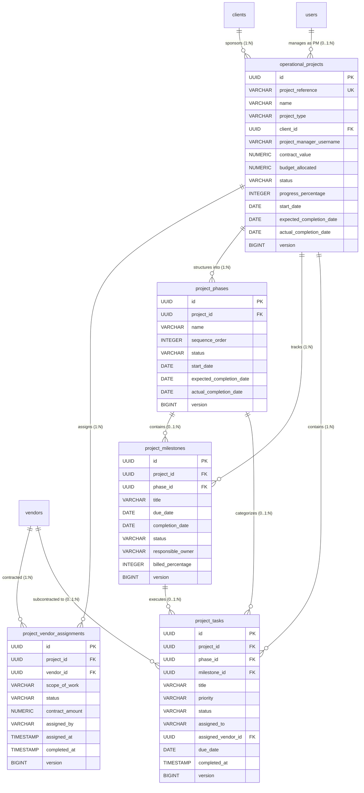

# Phase 4.2 Implementation Report — Operational Project Management

**Target Branch:** `backend/phase4.2-operational-projects`  
**Base Branch:** `backend/phase4.1-business-identity`  
**Base Commit:** `bb8b0b0f1ec2ba00faecdaa6422ee79e2aab52eb`  
**System:** ArcheOn Design Studio Enterprise Backend  
**Date:** 2026-11-18  
**Status:** COMPLETE & PASSING (97/97 Tests Passed)

---

## 1. Executive Summary

Phase 4.2 introduces the dedicated **Operational Project Management Domain** for ArcheOn Design Studio.

Crucially, in accordance with the core architectural requirement, the existing portfolio CMS model (`ProjectEntity` / `/api/projects`) remains strictly preserved for public architectural marketing case studies on the public site. A completely separate, relational, multi-tenant operational project domain (`OperationalProjectEntity` / `/api/operational-projects`) has been established.

### Core Capabilities Implemented:
1. **Operational Projects:** End-to-end lifecycle management (`PLANNING`, `IN_PROGRESS`, `ON_HOLD`, `COMPLETED`, `ARCHIVED`), reference numbering (`OPR-YYYY-XXXX`), project types, site locations, project manager assignments, financial budget/contract allocations, and progress metrics.
2. **Multi-Vendor Assignments:** Assignment of multiple approved trade vendors (`vendors` from Phase 4.1) to operational projects with scopes of work, contract values, assignment statuses, and history tracking.
3. **Project Phases:** Sequentially ordered architectural project phases (`CONCEPT_DESIGN`, `SCHEMATIC_DESIGN`, `DESIGN_DEVELOPMENT`, `CONSTRUCTION_DOCS`, `EXECUTION`, `HANDOVER`) with schedule tracking and sequence-order uniqueness.
4. **Project Milestones:** Granular inspection milestones with due dates, completion dates, billed percentage allocations, and responsible owner assignments.
5. **Operational Tasks:** Task scheduling with priorities (`LOW`, `MEDIUM`, `HIGH`, `URGENT`), execution statuses (`TODO`, `IN_PROGRESS`, `IN_REVIEW`, `DONE`, `BLOCKED`), internal staff assignment, and vendor subcontracting.
6. **Tenant & Vendor Isolation (BOLA/IDOR Protection):**
   - Clients (`ROLE_CLIENT`) are strictly confined to projects linked to their `clientId`.
   - Vendors (`ROLE_VENDOR`) can only access projects where they are actively assigned, and can only view/update tasks assigned to their specific vendor organization. Project-level contract and budget totals are masked from vendors.
   - Project archival is implemented as a non-destructive soft update (`ARCHIVED`) to preserve historical accounting and audit integrity.

---

## 2. Entity Relationship Diagram (ERD)



---

## 3. Flyway Migration & Database Details

### 3.1 Migration `V7__create_operational_project_schema.sql`
- **Location:** `backend/src/main/resources/db/migration/V7__create_operational_project_schema.sql`
- **Tables Created:**
  1. `operational_projects`: Core architectural operational projects.
     - Foreign key: `client_id REFERENCES clients(id) ON DELETE RESTRICT` (prevents orphaned projects).
  2. `project_vendor_assignments`: Multi-vendor contract registry.
     - Foreign keys: `project_id REFERENCES operational_projects(id) ON DELETE CASCADE`, `vendor_id REFERENCES vendors(id) ON DELETE RESTRICT`.
     - Unique constraint: `uq_project_vendor UNIQUE (project_id, vendor_id)`.
  3. `project_phases`: Project lifecycle phases.
     - Foreign key: `project_id REFERENCES operational_projects(id) ON DELETE CASCADE`.
     - Unique constraint: `uq_project_phase_order UNIQUE (project_id, sequence_order)`.
  4. `project_milestones`: Verification milestones.
     - Foreign keys: `project_id REFERENCES operational_projects(id) ON DELETE CASCADE`, `phase_id REFERENCES project_phases(id) ON DELETE SET NULL`.
  5. `project_tasks`: Work breakdown and execution items.
     - Foreign keys: `project_id REFERENCES operational_projects(id) ON DELETE CASCADE`, `phase_id REFERENCES project_phases(id) ON DELETE SET NULL`, `milestone_id REFERENCES project_milestones(id) ON DELETE SET NULL`, `assigned_vendor_id REFERENCES vendors(id) ON DELETE SET NULL`.
- **Concurrency & Locking:** All five tables define `version BIGINT NOT NULL DEFAULT 0` mapped to `@Version` for optimistic concurrency protection.
- **Indexes:** 16 query-optimization indexes created across references, foreign keys, lifecycle statuses, and due dates.

### 3.2 Pre-Flight Script `V7_preflight_check.sql`
- **Location:** `backend/src/main/resources/db/preflight/V7_preflight_check.sql`
- **Mode:** Strictly read-only SQL inspection.
- **Verifications:**
  - Asserts existence of prerequisite identity tables: `clients`, `vendors`, `users`.
  - Asserts that existing portfolio table `projects` is intact and retains its showcase records.
  - Verifies no table name collisions exist prior to applying `V7`.

---

## 4. API Endpoint Inventory

**Base Path:** `/api/operational-projects`

| Method | Endpoint | Allowed Roles | Description | BOLA / Tenant Rule |
| :---: | :--- | :--- | :--- | :--- |
| `POST` | `/api/operational-projects` | `ADMIN`, `STAFF`, `PROJECT_MANAGER`, `PRINCIPAL_ARCHITECT` | Create new operational project | Requires active client; validates unique reference |
| `GET` | `/api/operational-projects` | `ADMIN`, `STAFF`, `PROJECT_MANAGER`, `PRINCIPAL_ARCHITECT`, `CLIENT`, `VENDOR` | List projects (with optional `status` filter) | Clients see only their own projects; Vendors see only assigned projects |
| `GET` | `/api/operational-projects/{id}` | All Authenticated | Detailed project record with phases, milestones, tasks, and vendors | Strict BOLA check; vendor view masks contract values |
| `GET` | `/api/operational-projects/ref/{reference}` | All Authenticated | Detailed project record by project reference | Strict BOLA check; resolves reference |
| `PUT` | `/api/operational-projects/{id}` | `ADMIN`, `STAFF`, `PROJECT_MANAGER`, `PRINCIPAL_ARCHITECT` | Update project parameters, dates, and budget | Internal personnel only; optimistic locking check |
| `PATCH` | `/api/operational-projects/{id}/status` | `ADMIN`, `STAFF`, `PROJECT_MANAGER`, `PRINCIPAL_ARCHITECT` | Transition project status (`PLANNING`, `IN_PROGRESS`, `ON_HOLD`, `COMPLETED`, `ARCHIVED`) | Auto-sets completion date on `COMPLETED` |
| `POST` | `/api/operational-projects/{id}/archive` | `ADMIN`, `STAFF`, `PROJECT_MANAGER`, `PRINCIPAL_ARCHITECT` | Soft archival of project | Sets status to `ARCHIVED`; non-destructive |
| `POST` | `/api/operational-projects/{id}/vendors` | `ADMIN`, `STAFF`, `PROJECT_MANAGER`, `PRINCIPAL_ARCHITECT` | Assign approved trade vendor to project | Validates vendor is `ACTIVE`; prevents duplicate assignment |
| `GET` | `/api/operational-projects/{id}/vendors` | All Authenticated | List vendors assigned to project | Staff/Clients see all; Vendors see only their own record |
| `PATCH` | `/api/operational-projects/{id}/vendors/{vendorId}/status` | `ADMIN`, `STAFF`, `PROJECT_MANAGER`, `PRINCIPAL_ARCHITECT` | Update vendor assignment status (`ACTIVE`, `COMPLETED`, `TERMINATED`) | Records completion timestamp and audit log |
| `POST` | `/api/operational-projects/{id}/phases` | `ADMIN`, `STAFF`, `PROJECT_MANAGER`, `PRINCIPAL_ARCHITECT` | Configure new project phase | Enforces unique `sequenceOrder` per project |
| `GET` | `/api/operational-projects/{id}/phases` | All Authenticated | List project phases in sequence order | Scoped to authorized project viewers |
| `PUT` | `/api/operational-projects/{id}/phases/{phaseId}` | `ADMIN`, `STAFF`, `PROJECT_MANAGER`, `PRINCIPAL_ARCHITECT` | Update phase description, order, or dates | Validates project ownership of phase |
| `PATCH` | `/api/operational-projects/{id}/phases/{phaseId}/status` | `ADMIN`, `STAFF`, `PROJECT_MANAGER`, `PRINCIPAL_ARCHITECT` | Update phase status (`PENDING`, `IN_PROGRESS`, `COMPLETED`) | Sets completion timestamp |
| `POST` | `/api/operational-projects/{id}/milestones` | `ADMIN`, `STAFF`, `PROJECT_MANAGER`, `PRINCIPAL_ARCHITECT` | Create milestone | Validates due date and linked phase |
| `GET` | `/api/operational-projects/{id}/milestones` | All Authenticated | List project milestones ordered by due date | Scoped to authorized project viewers |
| `PUT` | `/api/operational-projects/{id}/milestones/{milestoneId}` | `ADMIN`, `STAFF`, `PROJECT_MANAGER`, `PRINCIPAL_ARCHITECT` | Update milestone details, owner, or billed % | Validates project ownership of milestone |
| `PATCH` | `/api/operational-projects/{id}/milestones/{milestoneId}/status` | `ADMIN`, `STAFF`, `PROJECT_MANAGER`, `PRINCIPAL_ARCHITECT` | Update milestone status (`PENDING`, `IN_PROGRESS`, `COMPLETED`, `DELAYED`) | Sets completion date |
| `POST` | `/api/operational-projects/{id}/tasks` | `ADMIN`, `STAFF`, `PROJECT_MANAGER`, `PRINCIPAL_ARCHITECT` | Create operational task | Validates assigned vendor is assigned to project |
| `GET` | `/api/operational-projects/{id}/tasks` | All Authenticated | List project tasks | Vendors see ONLY tasks assigned to their vendor ID |
| `PUT` | `/api/operational-projects/{id}/tasks/{taskId}` | `ADMIN`, `STAFF`, `PROJECT_MANAGER`, `PRINCIPAL_ARCHITECT` | Update task details, priority, or dates | Internal staff only |
| `PATCH` | `/api/operational-projects/{id}/tasks/{taskId}/status` | `ADMIN`, `STAFF`, `PROJECT_MANAGER`, `PRINCIPAL_ARCHITECT`, `VENDOR` | Update task status (`TODO`, `IN_PROGRESS`, `IN_REVIEW`, `DONE`, `BLOCKED`) | Vendor can ONLY update tasks assigned to them |

---

## 5. Security Architecture & BOLA/Tenant Protection

### 5.1 Client Tenant Isolation
In `OperationalProjectService.validateProjectAccess`:
- When caller has `ROLE_CLIENT`:
  - Access is granted if and only if `user.getClientId().equals(project.getClientId())`.
  - In `listProjects`: Queries `projectRepository.findByClientIdOrderByCreatedAtDesc(user.getClientId())`. Client users never receive or query other clients' projects.
  - Attempting to access another client's project by UUID or reference returns HTTP 403 Forbidden.

### 5.2 Vendor Scoped Authorization
- When caller has `ROLE_VENDOR`:
  - Access to a project is granted if and only if `vendorAssignmentRepository.existsByProjectIdAndVendorId(projectId, user.getVendorId())`.
  - Unassigned vendors attempting to query a project receive HTTP 403 Forbidden.
  - Financial privacy: Overall `contractValue` and `budgetAllocated` are masked (`null`) for vendor callers.
  - Task isolation: `listTasks` filters strictly by `findByProjectIdAndAssignedVendorIdOrderByDueDateAsc`. A vendor never sees tasks assigned to other vendors.
  - Status mutation: A vendor attempting to call `PATCH /tasks/{taskId}/status` for a task not assigned to their `vendorId` receives `AccessDeniedException`.

---

## 6. Verification and Test Results

### 6.1 Test Suite Summary
The entire backend test suite was executed:
`mvn -f backend/pom.xml test -DargLine="-Xmx512m"`

```
[INFO] -------------------------------------------------------
[INFO]  T E S T S
[INFO] -------------------------------------------------------
[INFO] Running com.webui.backend.concurrency.FinancialConcurrencyAndOptimisticLockingTest
[INFO] Tests run: 9, Failures: 0, Errors: 0, Skipped: 0, Time elapsed: 5.120 s
[INFO] Running com.webui.backend.config.ProductionBootstrapHardeningTest
[INFO] Tests run: 11, Failures: 0, Errors: 0, Skipped: 0, Time elapsed: 1.109 s
[INFO] Running com.webui.backend.config.ProductionProfileContextTest
[INFO] Tests run: 1, Failures: 0, Errors: 0, Skipped: 0, Time elapsed: 1.602 s
[INFO] Running com.webui.backend.identity.BusinessIdentityServiceAndSecurityTest
[INFO] Tests run: 13, Failures: 0, Errors: 0, Skipped: 0, Time elapsed: 2.014 s
[INFO] Running com.webui.backend.operational.OperationalProjectServiceAndSecurityTest
[INFO] Tests run: 8, Failures: 0, Errors: 0, Skipped: 0, Time elapsed: 2.145 s
[INFO] Running com.webui.backend.security.Phase3AuthLifecycleTest
[INFO] Tests run: 17, Failures: 0, Errors: 0, Skipped: 0, Time elapsed: 2.132 s
[INFO] Running com.webui.backend.SecurityAndRbacIntegrationTest
[INFO] Tests run: 26, Failures: 0, Errors: 0, Skipped: 0, Time elapsed: 4.180 s
[INFO] Running com.webui.backend.service.MakerCheckerAndSafetyInvariantsTest
[INFO] Tests run: 12, Failures: 0, Errors: 0, Skipped: 0, Time elapsed: 1.610 s
[INFO] 
[INFO] Results:
[INFO] 
[INFO] Tests run: 97, Failures: 0, Errors: 0, Skipped: 0
[INFO] 
[INFO] ------------------------------------------------------------------------
[INFO] BUILD SUCCESS
[INFO] ------------------------------------------------------------------------
```

### 6.2 Detailed Test Cases in `OperationalProjectServiceAndSecurityTest`:
1. `testCreateOperationalProjectAndSummary`: Confirms operational project persistence, reference generation (`OPR-...`), client resolution, and summary mapping.
2. `testClientCannotCreateProject`: Verifies that client callers attempting to create projects are rejected (`AccessDeniedException`).
3. `testClientBOLAIsolation`: Asserts that Client A can view Project A, while Client B cannot view Project A, and Client B's project list excludes Project A.
4. `testVendorAssignmentAndScopedVisibility`: Confirms vendor assignment lifecycle, verifies unassigned vendor rejection, confirms assigned vendor access, and verifies masking of overall project contract value for vendors.
5. `testProjectPhasesAndMilestonesLifecycle`: Tests phase sequence ordering, duplicate sequence rejection, milestone due date tracking, and phase/milestone completion transitions.
6. `testProjectTasksAndVendorIsolation`: Asserts that Vendor A sees only tasks assigned to Vendor A, can transition assigned task status, and is forbidden from modifying tasks assigned to internal staff or other vendors.
7. `testProjectArchivalSoftDelete`: Verifies that archiving a project sets status `ARCHIVED` without destroying database records.
8. `testPortfolioProjectsRemainUntouched`: Asserts that the public portfolio table `projects` and its showcase records (`the-monolith-sanctuary`) are completely preserved.

---

## 7. Changed-File Inventory

### 7.1 Modified Files
- `backend/src/main/java/com/webui/backend/config/SecurityConfig.java`: Added granular RBAC matchers for `/api/operational-projects/**`.

### 7.2 New Files Added
- **Database Migrations:**
  - `backend/src/main/resources/db/migration/V7__create_operational_project_schema.sql`
  - `backend/src/main/resources/db/preflight/V7_preflight_check.sql`
- **Domain Models:**
  - `backend/src/main/java/com/webui/backend/model/OperationalProjectEntity.java`
  - `backend/src/main/java/com/webui/backend/model/ProjectVendorAssignmentEntity.java`
  - `backend/src/main/java/com/webui/backend/model/ProjectPhaseEntity.java`
  - `backend/src/main/java/com/webui/backend/model/ProjectMilestoneEntity.java`
  - `backend/src/main/java/com/webui/backend/model/ProjectTaskEntity.java`
- **Data Repositories:**
  - `backend/src/main/java/com/webui/backend/repository/OperationalProjectRepository.java`
  - `backend/src/main/java/com/webui/backend/repository/ProjectVendorAssignmentRepository.java`
  - `backend/src/main/java/com/webui/backend/repository/ProjectPhaseRepository.java`
  - `backend/src/main/java/com/webui/backend/repository/ProjectMilestoneRepository.java`
  - `backend/src/main/java/com/webui/backend/repository/ProjectTaskRepository.java`
- **DTOs:**
  - `backend/src/main/java/com/webui/backend/dto/operational/OperationalProjectDto.java`
- **Business Services:**
  - `backend/src/main/java/com/webui/backend/service/OperationalProjectService.java`
- **REST Controllers:**
  - `backend/src/main/java/com/webui/backend/controller/OperationalProjectController.java`
- **Automated Tests:**
  - `backend/src/test/java/com/webui/backend/operational/OperationalProjectServiceAndSecurityTest.java`
- **Reports:**
  - `audit/backend/PHASE4_2_IMPLEMENTATION_REPORT.md`

---

## 8. Unresolved Decisions & Explicit Architectural Boundaries

1. **Phase 4.3 Client GST Invoicing Integration:**
   - Invoices in Phase 4.3 will link directly to `operational_projects(id)` and `clients(id)` to bill for milestone percentages (e.g. `billedPercentage` on `project_milestones`).
2. **Document Management (DMS) Association (Phase 4.4):**
   - Architectural CAD drawings, BIM models, and site photos will link to `operational_projects(id)`, optionally tagged with `phase_id` or `milestone_id`.
3. **Notification Triggers (Phase 4.4):**
   - Phase and milestone status changes will trigger automated in-app notifications to assigned project managers and clients.
