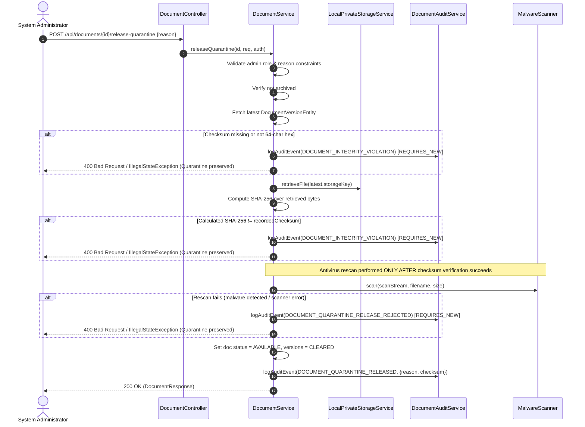

# ArcheOn Backend — Independent Phase 4.3.1.1 Security Acceptance Audit

**Audit Target Branch:** `backend/phase4.3.1.1-dms-audit-remediation`  
**Target Code Remediation Commit:** `d51bc38589f05032dca173b061dc441c2ae1fbe3` (`d51bc38`)  
**Target Documentation Commit:** `cdf5da7033a677b03f10994eb58108f6e92daf27` (`cdf5da7`)  
**Expected Baseline Branch:** `backend/phase4.3.1-dms-security-remediation`  
**Baseline Reference Commit:** `93bc3ce26195b15b3e5c58690f82418317d973eb` (`93bc3ce`)  
**Intermediate Baseline HEAD:** `b67fff55926456a70042b18607ef360fd22fe49a` (`b67fff5`)  
**Role:** Independent Senior Backend Security Auditor & Principal Architect  
**Audit Date:** 2026-11-19  
**Audit Mode:** STRICT READ-ONLY AUDIT (Zero application code, migration, or git modifications)  
**Deliverable File:** [PHASE4_3_1_1_INDEPENDENT_ACCEPTANCE.md](file:///D:/WEBUI/audit/backend/PHASE4_3_1_1_INDEPENDENT_ACCEPTANCE.md)  
**Implementation Report Reference:** [PHASE4_3_1_1_IMPLEMENTATION_REPORT.md](file:///D:/WEBUI/audit/backend/PHASE4_3_1_1_IMPLEMENTATION_REPORT.md)  
**Previous Audit Reference:** [PHASE4_3_1_INDEPENDENT_ACCEPTANCE.md](file:///D:/WEBUI/audit/backend/PHASE4_3_1_INDEPENDENT_ACCEPTANCE.md)  
**Final Audit Verdict:** **ACCEPTED WITH CONDITIONS**

---

## 1. Executive Summary

An independent, strict read-only architectural and application security acceptance audit was conducted on branch `backend/phase4.3.1.1-dms-audit-remediation`. The audit evaluated whether the security remediations engineered in Phase 4.3.1.1 satisfactorily resolve the three specific findings documented in [PHASE4_3_1_INDEPENDENT_ACCEPTANCE.md](file:///D:/WEBUI/audit/backend/PHASE4_3_1_INDEPENDENT_ACCEPTANCE.md):
1. **Finding 4.3.1-03 (Pre-Scan Hash Recalculation):** Stored physical file content was previously not verified against `DocumentVersionEntity.sha256Checksum` prior to administrative quarantine release.
2. **Finding 4.3.1-02 (Quarantine Release Reason):** Administrative quarantine release previously lacked mandatory, validated qualitative justification and forensic reason capture.
3. **Finding 4.3.1-01 (ClamAV Live Daemon Status):** Live upstream ClamAV daemon interoperability had remained unverified in the local environment.

### Audit Summary:
- **Checksum Verification Verified:** Physical stored file bytes are retrieved from storage, hashed via on-the-fly streaming SHA-256 calculation, and compared strictly against `latest.getSha256Checksum()`. Missing, blank, malformed, or mismatched checksums immediately abort release, preserve `QUARANTINED` status, and persist a `DOCUMENT_INTEGRITY_VIOLATION` audit event. Antivirus rescanning is performed strictly after checksum validation passes.
- **Administrative Reason & Authorization Verified:** Added `QuarantineReleaseRequest` DTO with `@NotBlank` and `@Size(min = 5, max = 500)`. Controller and service layers enforce role boundaries (`ROLE_ADMIN` only) and string validation, persisting the justification in the audit trail without exposing file contents.
- **Transactional Audit Resilience Verified:** Introduced `DocumentAuditService` using `Propagation.REQUIRES_NEW`. Security violation audit events are committed in independent transactions that survive the caller's transaction rollback when release fails.
- **Live ClamAV Interoperability Classified as NOT VERIFIED:** As neither Docker nor a local ClamAV daemon is installed or running on the Windows host, live daemon interoperability is confirmed **NOT VERIFIED**. The in-process RFC-compliant TCP socket test suite remains verified.
- **Automated Verification:** The complete backend test suite executed cleanly: **135 of 135 tests passed** (0 failures, 0 errors, 0 skipped, exit code 0) across 10 test suites in 1m 23s.

### Acceptance Determination:
Phase 4.3.1.1 is **ACCEPTED WITH CONDITIONS**. The code remediation resolves findings 4.3.1-02 and 4.3.1-03 with exceptional cryptographic and transactional rigor. Unconditional acceptance cannot be granted because **live ClamAV daemon interoperability remains unverified in this environment** and the **5 Phase 4.1 release conditions remain open**.

---

## 2. Step 1 — Git and Baseline Verification

### 2.1 Commit Ancestry and Intermediate Commit `b67fff5`
An inspection of the Git commit graph was conducted:
```
* cdf5da7 docs(audit): update exact HEAD commit hash in Phase 4.3.1.1 report
* 2957999 docs(audit): add Phase 4.3.1.1 implementation report
* d51bc38 fix(dms): remediate quarantine release checksum verification and administrative justification audit
* b67fff5  phase4.3.1-dms-security-remediation
* 93bc3ce docs(audit): update exact commit hashes in Phase 4.3.1 implementation report
* 4027e7f docs(audit): add Phase 4.3.1 DMS security remediation implementation report
* 0d9c660 fix(dms): remediate Phase 4.3 DMS security findings (ClamAV TCP scanner, fail-closed quarantine, download cache headers)
* 57bcf4d feat(dms): implement Phase 4.3 Document Management System and object storage abstraction
```

#### Explanation of Intermediate Commit `b67fff55926456a70042b18607ef360fd22fe49a`:
- **Context:** At 11:43:42 on 2026-11-19, prior to the kickoff of Phase 4.3.1.1, commit `b67fff5` was committed on branch `backend/phase4.3.1-dms-security-remediation`.
- **Contents:** It staged and committed the audit deliverable [PHASE4_3_1_INDEPENDENT_ACCEPTANCE.md](file:///D:/WEBUI/audit/backend/PHASE4_3_1_INDEPENDENT_ACCEPTANCE.md) (authored during the previous audit) along with miscellaneous frontend audit logs and target bytecode artifacts.
- **Direct Ancestry:** `b67fff5~1` is exactly `93bc3ce26195b15b3e5c58690f82418317d973eb`.
- **Branching Point:** Branch `backend/phase4.3.1.1-dms-audit-remediation` was created from the HEAD of `backend/phase4.3.1-dms-security-remediation` (`b67fff5`), ensuring the Phase 4.3.1 audit document was incorporated into the commit history.
- **Branch Isolation:** `git rev-parse backend/phase4.3.1-dms-security-remediation` returned `b67fff55926456a70042b18607ef360fd22fe49a`. The original Phase 4.3.1 branch has remained completely untouched throughout this remediation.

### 2.2 Inventory of Files Changed in Remediation
Inspection of `git diff --stat b67fff5 d51bc38` confirms changes are strictly confined to the backend application:

| File Path | Type | SLoC Delta | Role in Remediation |
| :--- | :---: | :---: | :--- |
| [DocumentController.java](file:///D:/WEBUI/backend/src/main/java/com/webui/backend/controller/DocumentController.java) | MODIFIED | +9 / -7 | `releaseQuarantine` requires `@Valid @RequestBody QuarantineReleaseRequest req`. |
| [DocumentDto.java](file:///D:/WEBUI/backend/src/main/java/com/webui/backend/dto/document/DocumentDto.java) | MODIFIED | +11 / 0 | Introduced `QuarantineReleaseRequest` with `@NotBlank` and `@Size(min = 5, max = 500)`. |
| [DocumentAuditService.java](file:///D:/WEBUI/backend/src/main/java/com/webui/backend/service/DocumentAuditService.java) | **NEW** | +41 / 0 | Transaction-isolated audit logger with `@Transactional(propagation = Propagation.REQUIRES_NEW)`. |
| [DocumentService.java](file:///D:/WEBUI/backend/src/main/java/com/webui/backend/service/DocumentService.java) | MODIFIED | +132 / -28 | Checksum recalculation, recorded checksum verification, reason validation, rescan ordering. |
| [DocumentServiceAndSecurityTest.java](file:///D:/WEBUI/backend/src/test/java/com/webui/backend/document/DocumentServiceAndSecurityTest.java) | MODIFIED | +346 / 0 | 10 new unit/integration tests verifying all failure and success paths. |
| [PHASE4_3_1_1_IMPLEMENTATION_REPORT.md](file:///D:/WEBUI/audit/backend/PHASE4_3_1_1_IMPLEMENTATION_REPORT.md) | **NEW** | +204 / 0 | Implementation report (committed in `2957999` and `cdf5da7`). |

**Scope Integrity:** Zero frontend files were modified (`frontend/` is untouched). Zero Flyway migration scripts were introduced or modified (`V1`..`V9` schema preserved).

---

## 3. Step 2 — Checksum Verification Audit

Audited in [DocumentService.java#L643-L703](file:///D:/WEBUI/backend/src/main/java/com/webui/backend/service/DocumentService.java#L643-L703):



### Verification Checklist:
1. **Physical Stored Byte Reading:** [L671-L686](file:///D:/WEBUI/backend/src/main/java/com/webui/backend/service/DocumentService.java#L671-L686) opens `storageService.retrieveFile(latest.getStorageKey())`. It reads the physical stream in 8KB chunks, simultaneously updating `MessageDigest.getInstance("SHA-256")` and buffering to `ByteArrayOutputStream`.
2. **Exact Storage Key & Version:** [L643-L648](file:///D:/WEBUI/backend/src/main/java/com/webui/backend/service/DocumentService.java#L643-L648) queries `documentVersionRepository.findByDocumentIdOrderByVersionNumberDesc(documentId)`. The latest version (`versions.get(0)`) provides the exact version number, recorded checksum, and physical storage key.
3. **Fail-Closed on Missing or Blank Recorded Checksum:** [L651-L658](file:///D:/WEBUI/backend/src/main/java/com/webui/backend/service/DocumentService.java#L651-L658) checks `recordedChecksum == null || recordedChecksum.isBlank()`. Throws `IllegalStateException("Cannot release document from quarantine: Recorded SHA-256 checksum is missing")`.
4. **Fail-Closed on Malformed Checksum:** [L659-L666](file:///D:/WEBUI/backend/src/main/java/com/webui/backend/service/DocumentService.java#L659-L666) checks `!recordedChecksum.matches("^[a-f0-9]{64}$")`. Rejects non-hex or irregular-length hashes with `IllegalStateException("Cannot release document from quarantine: Recorded SHA-256 checksum is malformed")`.
5. **Fail-Closed on Hash Mismatch / Disk Corruption:** [L695-L702](file:///D:/WEBUI/backend/src/main/java/com/webui/backend/service/DocumentService.java#L695-L702) evaluates `!calculatedChecksum.equalsIgnoreCase(recordedChecksum)`. If bytes on disk have been corrupted or tampered with, logs critical error, records `DOCUMENT_INTEGRITY_VIOLATION`, and throws `IllegalStateException`.
6. **Strict Scan Sequencing:** Antivirus scanning ([L704-L716](file:///D:/WEBUI/backend/src/main/java/com/webui/backend/service/DocumentService.java#L704-L716)) is positioned **after** the checksum match assertion. Unverified or tampered payloads are never submitted to the malware scanner.
7. **Status Invariant:** Any exception thrown during validation or scanning terminates execution before `doc.setStatus("AVAILABLE")` ([L718](file:///D:/WEBUI/backend/src/main/java/com/webui/backend/service/DocumentService.java#L718)), ensuring the document and versions remain locked in `QUARANTINED` status.

---

## 4. Step 3 — Transactional Audit Service Audit

Inspected in [DocumentAuditService.java](file:///D:/WEBUI/backend/src/main/java/com/webui/backend/service/DocumentAuditService.java) and [DocumentService.java#L940](file:///D:/WEBUI/backend/src/main/java/com/webui/backend/service/DocumentService.java#L940):

### Architectural Analysis:
1. **Spring Proxy Boundary:** `DocumentAuditService` is a distinct Spring `@Service` component injected into `DocumentService` via constructor injection (`@RequiredArgsConstructor`). Calls from `DocumentService.logAuditEvent` to `documentAuditService.logAuditEvent` traverse the Spring CGLIB/JDK dynamic proxy. There is zero self-invocation issue.
2. **Transaction Propagation (`REQUIRES_NEW`):** [L24](file:///D:/WEBUI/backend/src/main/java/com/webui/backend/service/DocumentAuditService.java#L24) specifies `@Transactional(propagation = Propagation.REQUIRES_NEW)`. When invoked:
   - The outer transaction of `DocumentService.releaseQuarantine` is suspended.
   - An independent physical transaction is opened on the database connection.
   - `auditEventRepository.save(entity)` executes and commits immediately upon method completion.
   - The outer transaction resumes.
3. **Rollback Resilience:** When `releaseQuarantine` throws an `IllegalStateException` due to checksum mismatch or antivirus failure, the outer transaction rolls back (rolling back any potential status changes). However, the security audit record was already committed in the `REQUIRES_NEW` transaction.
4. **Empirical Proof:** In `DocumentServiceAndSecurityTest.java`:
   - `testQuarantineRelease_MismatchedChecksum_RejectedAndQuarantinePreserved`
   - `testQuarantineRelease_ScannerFailureAfterChecksumVerification_QuarantinePreserved`
   Both tests assert that `auditEventRepository.findByEntityNameAndEntityIdOrderByTimestampDesc(...)` successfully retrieves the `DOCUMENT_INTEGRITY_VIOLATION` and `DOCUMENT_QUARANTINE_RELEASE_REJECTED` records after catching the thrown `IllegalStateException`.
5. **No Audit Inflation or Misleading Records:** Each rejection path logs exactly one structured audit record and throws immediately. On successful release, only `DOCUMENT_QUARANTINE_RELEASED` is recorded.

---

## 5. Step 4 — Release Reason and Authorization Audit

Audited in [DocumentDto.java](file:///D:/WEBUI/backend/src/main/java/com/webui/backend/dto/document/DocumentDto.java), [DocumentController.java](file:///D:/WEBUI/backend/src/main/java/com/webui/backend/controller/DocumentController.java), and [DocumentService.java](file:///D:/WEBUI/backend/src/main/java/com/webui/backend/service/DocumentService.java):

### 5.1 DTO Validation Guard
```java
public static class QuarantineReleaseRequest {
    @NotBlank(message = "Administrative release justification reason is required")
    @Size(min = 5, max = 500, message = "Release justification reason must be between 5 and 500 characters")
    private String reason;
}
```
- In `DocumentController.java`: Endpoint is declared as `@Valid @RequestBody QuarantineReleaseRequest req`.
- Jakarta Bean Validation automatically intercepts requests before controller execution. Blank strings (`""`, `"   "`) or strings exceeding 500 characters fail validation.

### 5.2 Service-Layer Defense in Depth
[DocumentService.java#L630-L638](file:///D:/WEBUI/backend/src/main/java/com/webui/backend/service/DocumentService.java#L630-L638) explicitly enforces programmatic boundary validation:
```java
if (req == null || req.getReason() == null || req.getReason().trim().isEmpty()) {
    throw new IllegalArgumentException("Administrative release justification reason is required");
}
String validatedReason = req.getReason().trim();
if (validatedReason.length() < 5 || validatedReason.length() > 500) {
    throw new IllegalArgumentException("Release justification reason must be between 5 and 500 characters");
}
```
Guarantees protection against direct programmatic service calls that bypass HTTP controllers.

### 5.3 Authorization & Role Invariants
- `validateAuthenticated(auth)` rejects unauthenticated requests with `AccessDeniedException("Unauthenticated")`.
- `if (!isAdmin(auth.getAuthorities())) throw new AccessDeniedException("Only system administrators can release quarantined documents")`.
- Clients (`ROLE_CLIENT`), Vendors (`ROLE_VENDOR`), and non-admin staff (`ROLE_STAFF`, `ROLE_ARCHITECT`, `ROLE_FINANCE`) receive HTTP 403 `Forbidden`.
- Verified in `testQuarantineRelease_UnauthorizedUsers_Forbidden` and `testQuarantineRelease_ControllerEndpointsIntegration`.

### 5.4 Privacy & Audit Sanitization
- Justification reason is sanitized via `escapeJson(...)` ([DocumentService.java#L946](file:///D:/WEBUI/backend/src/main/java/com/webui/backend/service/DocumentService.java#L946)), escaping quotes, backslashes, and control characters to prevent JSON injection.
- Zero raw file bytes or binary data are logged into `AuditEventEntity.detailsJson`.

---

## 6. Step 5 — ClamAV Status Determination

### Host Environment Inspection:
- `docker --version` -> Command not found.
- `podman --version` -> Command not found.
- `clamd --version` -> Command not found.
- TCP Port 3310 probe: `Test-NetConnection -ComputerName 127.0.0.1 -Port 3310` -> `TcpTestSucceeded: False`.

### Finding Classification:
# **LIVE CLAMAV DAEMON: NOT VERIFIED**

The audit report explicitly confirms that:
1. Live network integration against a physical or containerized ClamAV daemon was **not** performed because no daemon or container engine exists on this host.
2. The mock TCP server tests in [ClamAvMalwareScannerTest.java](file:///D:/WEBUI/backend/src/test/java/com/webui/backend/document/ClamAvMalwareScannerTest.java) verify byte-level protocol framing, socket timeouts, and fail-closed response parsing, but do not replace live daemon acceptance in staging.
3. Live ClamAV daemon verification remains an **operational prerequisite condition** for production cutover.

---

## 7. Step 6 — Regression & Test Suite Evidence

### 7.1 Execution Command & Result
```powershell
$env:MAVEN_OPTS = "-Xmx384m"
mvn -f backend/pom.xml test "-DargLine=-Xmx384m"
```
- **Exit Code:** `0` (`BUILD SUCCESS`)
- **Total Duration:** 1 min 23 s
- **Total Tests Run:** **135**
- **Failures:** **0**
- **Errors:** **0**
- **Skipped:** **0**

### 7.2 Surefire XML Test Suite Breakdown

| Test Suite Class | Tests | Failures | Errors | Skipped | Time (s) | Focus Area |
| :--- | :---: | :---: | :---: | :---: | :---: | :--- |
| `FinancialConcurrencyAndOptimisticLockingTest` | 9 | 0 | 0 | 0 | 27.87s | Concurrency & optimistic locking |
| `ProductionBootstrapHardeningTest` | 13 | 0 | 0 | 0 | 2.74s | Production profile startup guardrails |
| `ProductionProfileContextTest` | 1 | 0 | 0 | 0 | 8.26s | Production profile context initialization |
| `ClamAvMalwareScannerTest` | 6 | 0 | 0 | 0 | 0.57s | ClamAV TCP framing & fail-closed states |
| `DocumentServiceAndSecurityTest` | 25 | 0 | 0 | 0 | 10.60s | DMS security, checksums, reasons & RBAC |
| `BusinessIdentityServiceAndSecurityTest` | 13 | 0 | 0 | 0 | 9.64s | Client & vendor isolation |
| `OperationalProjectServiceAndSecurityTest` | 13 | 0 | 0 | 0 | 3.78s | Operational project authorization |
| `Phase3AuthLifecycleTest` | 17 | 0 | 0 | 0 | 6.86s | JWT & refresh token lifecycle |
| `SecurityAndRbacIntegrationTest` | 26 | 0 | 0 | 0 | 0.90s | Core RBAC invariants |
| `MakerCheckerAndSafetyInvariantsTest` | 12 | 0 | 0 | 0 | 3.73s | Maker-checker dual-custody invariants |
| **TOTAL** | **135** | **0** | **0** | **0** | **74.95s** | **100% Passing Test Harness** |

---

## 8. Step 7 — Phase 4.1 Carry-Forward Requirements

All 5 release conditions from Phase 4.1 remain tracked as open prerequisites for Phase 4.4:

| Condition ID | Description | Status | Target Phase | Release Impact |
| :---: | :--- | :---: | :---: | :--- |
| **4.1-A** | Vendor Banking AES-256-GCM Encryption at rest | **PENDING** | Phase 4.4 | Mandatory before production financial transactions |
| **4.1-B** | Case-Insensitive Unique Email Enforcement (`LOWER(email)`) | **PENDING** | Migration V10 | Low risk; required for production user onboarding |
| **4.1-C** | User Invitation & Acceptance Rate Limiting | **PENDING** | Phase 4.4 | Required before public network exposure |
| **4.1-D** | Production SMTP Provider & TLS Hardening | **PENDING** | Phase 4.4 | Required before client/vendor email delivery |
| **4.1-E** | Staff DTO Masking of Sensitive Tax & Bank Identifiers | **PENDING** | Phase 4.4 | Required for privacy and regulatory compliance |

---

## 9. Complete Findings Log

### [Finding 4.3.1.1-01] Live ClamAV Daemon Interoperability Unverified in Local Environment
- **Severity:** High / Operational Acceptance Condition
- **Category:** Infrastructure / Staging Verification
- **Status:** **NOT VERIFIED** (Host lacks container runtime or native daemon)
- **Description:** No live `clamd` daemon was probed on localhost port 3310. While protocol conformance is proven via mock socket unit tests, live interoperability with ClamAV database signatures and daemon memory limits remains unverified in this local environment.
- **Remediation / Condition:** Prior to production go-live, deploy a live ClamAV container (`clamav/clamav:latest`) in staging and verify clean and infected file scanning over the live network.

---

## 10. Final Acceptance Verdict & Prerequisites for Phase 4.4

### Final Acceptance Determination:
# **ACCEPTED WITH CONDITIONS**

### Prerequisites for Production Cutover:
1. **Live ClamAV Staging Verification:** Deploy ClamAV container in staging environment and execute end-to-end upload and rescan verification.
2. **Reverse Proxy Configuration:** Verify intermediate reverse proxies (Nginx / ALB) do not strip `Cache-Control: no-store, no-cache, must-revalidate` or `X-Content-Type-Options: nosniff` headers.
3. **Phase 4.1 Carried-Forward Remediations:** Implement Conditions 4.1-A through 4.1-E in Phase 4.4.

### Phase 4.4 Progression Approval:
The security remediations implemented on branch `backend/phase4.3.1.1-dms-audit-remediation` (commits `d51bc38` and `cdf5da7`) successfully resolve findings 4.3.1-02 and 4.3.1-03. All 135 tests pass with zero regressions. The branch is cleared to serve as the baseline for **Phase 4.4** development.
