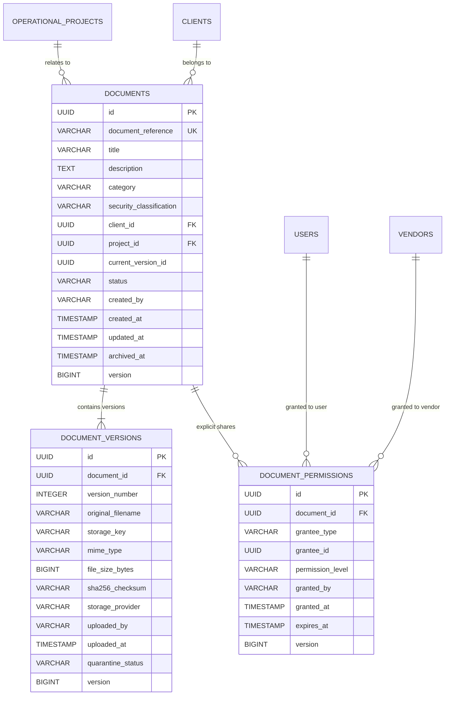
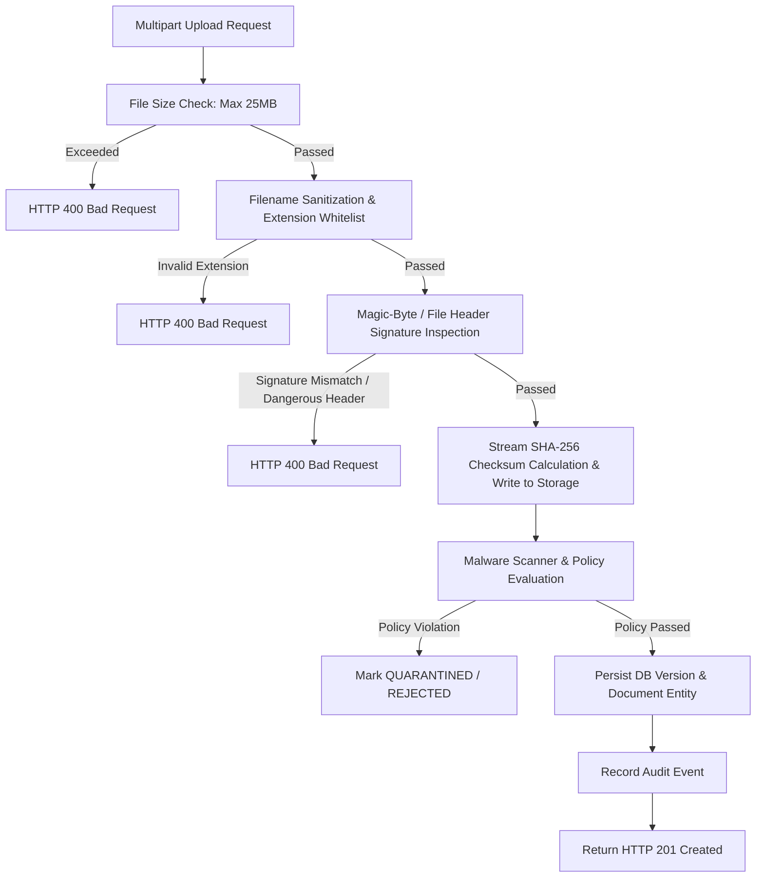

# ArcheOn Design Studio — Phase 4.3 Architecture Design
## Document Management System (DMS) & Secure Object Storage Subsystem

**Document Version:** 1.0.0  
**Phase:** 4.3 — Document Management  
**Branch:** `backend/phase4.3-document-management`  
**Base Commit:** `506d2eb2ba788c3cbeb59c119508b021466b4cef`  
**Author:** Principal Software Architect & Lead Security Engineer  
**Date:** 2026-11-18  

---

## 1. Executive Summary & Objective

Phase 4.3 introduces the **Document Management System (DMS)** to the ArcheOn Design Studio platform. Architecture and design studios handle sensitive project blueprints, architectural CAD drawings (DWG/DXF), contracts, client agreements, construction site progress photos, material specification sheets, vendor submittals, and financial billing records.

The primary objective of Phase 4.3 is to establish an enterprise-grade, secure, multi-tenant, and role-governed document management engine. The system enforces strict architectural boundaries:
1. **Physical Byte Storage Decoupling:** File contents are stored strictly in private, isolated file storage (with an abstraction allowing drop-in object storage migration like AWS S3 or MinIO). **File bytes are never stored directly in PostgreSQL database columns.**
2. **Private Storage Only:** No direct, public URLs or static web server mappings exist for document files. Every file download requires an authenticated session and strict dynamic authorization checks.
3. **Defense-in-Depth Upload Security:** Multi-layered upload pipeline enforcing safe UUID storage key generation, path traversal immunity, magic-byte file signature validation, MIME/extension whitelisting, cryptographic SHA-256 integrity calculation, and pluggable malware quarantine policies.
4. **Strict Multi-Tenant & Role Authorization:** Granular authorization combining studio staff roles, client ownership (`clientId`), active vendor assignment verification on operational projects, and classification-based compartmentalization (`PUBLIC_CLIENT`, `INTERNAL_STAFF`, `CONFIDENTIAL_FINANCE`, `RESTRICTED_LEGAL`).
5. **Immutable Versioning & Lifecycle Governance:** Append-only versioning with non-overwriting storage keys, optimistic locking, and audited state transitions (`QUARANTINED`, `AVAILABLE`, `RESTRICTED`, `ARCHIVED`, `REJECTED`).
6. **Comprehensive Tamper-Evident Audit Logging:** Every access, mutation, classification change, download, and permission modification is recorded in the platform's `audit_events` ledger.

---

## 2. Domain Entities & Database Schema Design

### 2.1 Relational Architecture

The DMS schema is defined across three relational tables in Flyway migration `V9__create_document_management_schema.sql`:



### 2.2 Table Definitions

#### `documents`
- `id` (UUID, Primary Key)
- `document_reference` (VARCHAR(64), NOT NULL, UNIQUE): Canonical identifier, e.g., `DOC-2026-XXXX`.
- `title` (VARCHAR(255), NOT NULL): Human-readable document title.
- `description` (TEXT): Detailed description or purpose.
- `category` (VARCHAR(64), NOT NULL): Categorization of architectural records:
  - `CONTRACT`: Legal agreements, terms of service, engagement letters.
  - `BLUEPRINT_DRAWING`: Architectural elevations, structural drawings, CAD models (DWG, DXF, PDF).
  - `SPECIFICATION`: Material specifications, engineering standards, finish schedules.
  - `INVOICE_RECEIPT`: Vendor invoices, purchase orders, client billing receipts.
  - `SITE_PHOTO`: Progress documentation, site audit photos, safety inspections.
  - `LEGAL_PERMIT`: Building permits, municipal sanctions, environmental clearances.
  - `OTHER`: General correspondence, meeting minutes.
- `security_classification` (VARCHAR(32), NOT NULL DEFAULT 'INTERNAL_STAFF'):
  - `PUBLIC_CLIENT`: Accessible to assigned client, assigned vendors (with grant), and studio staff.
  - `INTERNAL_STAFF`: Accessible only to internal studio staff (`ADMIN`, `STAFF`, `PROJECT_MANAGER`, `PRINCIPAL_ARCHITECT`). Clients and vendors are blocked.
  - `CONFIDENTIAL_FINANCE`: Accessible only to internal finance officers (`FINANCE_MANAGER`, `FINANCE_MAKER`, `FINANCE_CHECKER`, `FINANCE_AUDIT`, `ADMIN`).
  - `RESTRICTED_LEGAL`: Accessible only to executive legal/admin personnel (`ADMIN`, `PRINCIPAL_ARCHITECT`).
- `client_id` (UUID, NULLABLE): Foreign key referencing `clients(id)` with `ON DELETE RESTRICT`.
- `project_id` (UUID, NULLABLE): Foreign key referencing `operational_projects(id)` with `ON DELETE RESTRICT`.
- `current_version_id` (UUID, NULLABLE): Pointer to the active head version.
- `status` (VARCHAR(32), NOT NULL DEFAULT 'AVAILABLE'):
  - `QUARANTINED`: Temporarily held pending malware scanning/verification.
  - `AVAILABLE`: Normal operational state, accessible to authorized parties.
  - `RESTRICTED`: Elevated protection requiring explicit permission grants.
  - `ARCHIVED`: Read-only historical record; mutations and new versions are disallowed.
  - `REJECTED`: Blocked or invalidated due to security policy violations.
- `created_by` (VARCHAR(50), NOT NULL): Username of initial uploader.
- `created_at` (TIMESTAMP, NOT NULL DEFAULT CURRENT_TIMESTAMP).
- `updated_at` (TIMESTAMP).
- `archived_at` (TIMESTAMP): Set when status transitions to `ARCHIVED`.
- `version` (BIGINT, NOT NULL DEFAULT 0): Optimistic locking counter.

#### `document_versions`
- `id` (UUID, Primary Key)
- `document_id` (UUID, NOT NULL): Foreign key referencing `documents(id)` with `ON DELETE RESTRICT`.
- `version_number` (INTEGER, NOT NULL): Monotonically increasing sequence (1, 2, 3...) per document.
- `original_filename` (VARCHAR(255), NOT NULL): Client-submitted filename, sanitized for display.
- `storage_key` (VARCHAR(500), NOT NULL): Unique internal storage path generated server-side.
- `mime_type` (VARCHAR(128), NOT NULL): Verified MIME type.
- `file_size_bytes` (BIGINT, NOT NULL): Exact size in bytes.
- `sha256_checksum` (VARCHAR(64), NOT NULL): Cryptographic digest computed during upload stream.
- `storage_provider` (VARCHAR(32), NOT NULL DEFAULT 'LOCAL_PRIVATE'): Provider identifier (`LOCAL_PRIVATE`, `S3_COMPATIBLE`).
- `uploaded_by` (VARCHAR(50), NOT NULL): Username who created this version.
- `uploaded_at` (TIMESTAMP, NOT NULL DEFAULT CURRENT_TIMESTAMP).
- `quarantine_status` (VARCHAR(32), NOT NULL DEFAULT 'CLEARED'): (`QUARANTINED`, `CLEARED`, `REJECTED`).
- `version` (BIGINT, NOT NULL DEFAULT 0): Optimistic locking counter.
- **Constraints:** `UNIQUE (document_id, version_number)` to prevent concurrent version collision.

#### `document_permissions`
- `id` (UUID, Primary Key)
- `document_id` (UUID, NOT NULL): Foreign key referencing `documents(id)` with `ON DELETE CASCADE`.
- `grantee_type` (VARCHAR(32), NOT NULL): `VENDOR` or `USER`.
- `grantee_id` (UUID, NOT NULL): Foreign key to `vendors(id)` or `users(id)`.
- `permission_level` (VARCHAR(32), NOT NULL DEFAULT 'READ'): `READ` or `READ_WRITE`.
- `granted_by` (VARCHAR(50), NOT NULL): Username who authorized the grant.
- `granted_at` (TIMESTAMP, NOT NULL DEFAULT CURRENT_TIMESTAMP).
- `expires_at` (TIMESTAMP): Optional expiry timestamp.
- `version` (BIGINT, NOT NULL DEFAULT 0).
- **Constraints:** `UNIQUE (document_id, grantee_type, grantee_id)`.

---

## 3. Storage Abstraction & Physical Security

### 3.1 Storage Abstraction Interface
To insulate application services from storage media specifics and allow zero-downtime migration to cloud object stores (S3, GCS, Azure Blob, MinIO), the system defines:

```java
public interface DocumentStorageService {
    String storeFile(InputStream inputStream, long size, String mimeType, String storageKey);
    InputStream retrieveFile(String storageKey);
    void deleteFile(String storageKey);
    boolean fileExists(String storageKey);
    long getFileSize(String storageKey);
}
```

### 3.2 Safe Server-Side Storage Key Generation
Storage keys are generated entirely on the server using deterministic partitions and cryptographically secure random UUIDs:
```
documents/{year}/{month}/{documentId}/{versionId}.bin
```
**Security Guarantees:**
- No user-controlled directory structure or extension is used in the filesystem path.
- Path traversal sequences (`../`, `..\\`, `%2e%2e%2f`, null bytes) are impossible because the path is built from server variables (`LocalDate.now()`, `UUID.randomUUID()`).
- File extension is omitted or normalized to `.bin` in raw storage to prevent web server execution engines from ever interpreting uploaded files as scripts.

### 3.3 Transactional Isolation & Orphaned File Cleanup
When a user uploads a file, the byte stream is written to storage first, computing its SHA-256 hash. If the subsequent database transaction fails (e.g., database constraint violation, optimistic locking conflict, or unhandled exception), the service catches the exception, invokes `storageService.deleteFile(storageKey)`, and rolls back cleanly to prevent orphaned ghost files on the filesystem.

---

## 4. Multi-Layer Upload Security Pipeline



### 4.1 Allowed File Types & Magic-Byte Signatures

| File Extension | Target Content Type | Magic Bytes / Header Signature |
|:---|:---|:---|
| `.pdf` | `application/pdf` | `%PDF-` (`0x25, 0x50, 0x44, 0x46, 0x2D`) |
| `.png` | `image/png` | `0x89, 0x50, 0x4E, 0x47, 0x0D, 0x0A, 0x1A, 0x0A` |
| `.jpg`, `.jpeg` | `image/jpeg` | `0xFF, 0xD8, 0xFF` |
| `.dwg` | `application/acad`, `application/x-dwg` | `AC10` / `0x41, 0x43, 0x31, 0x30` |
| `.dxf` | `application/dxf`, `text/plain` | Header contains `0\nSECTION` or `AutoCAD` |
| `.xlsx` | `application/vnd.openxmlformats...` | `PK\x03\x04` (`0x50, 0x4B, 0x03, 0x04`) |
| `.csv` | `text/csv`, `text/plain` | Plain text structure; verified non-executable |

### 4.2 Prohibited Executable & Script Types
Any file with extensions such as `.exe`, `.bat`, `.cmd`, `.sh`, `.ps1`, `.vbs`, `.js`, `.jsp`, `.asp`, `.aspx`, `.php`, `.jar`, `.war`, `.py`, `.elf` or with executable magic bytes (e.g. `MZ` for PE executables, `\x7fELF`) is rejected immediately with HTTP 400.

---

## 5. Granular Multi-Tenant & Role-Based Access Control (RBAC)

The system enforces authorization across four dimensions:
1. **System Role:** The authenticated user's role (`ADMIN`, `STAFF`, `PROJECT_MANAGER`, `PRINCIPAL_ARCHITECT`, `FINANCE_MANAGER`, `CLIENT`, `VENDOR`).
2. **Entity Ownership:**
   - **Clients:** Can only view documents linked to their own `clientId` (`doc.client_id == user.clientId`) AND where the classification is `PUBLIC_CLIENT`.
   - **Vendors:** Can only view documents if they have an **ACTIVE** assignment on `doc.project_id` AND have an explicit grant in `document_permissions` for that document.
3. **Security Classification:**
   - `PUBLIC_CLIENT`: Accessible by Studio Staff, assigned Client, and explicitly permitted Vendors.
   - `INTERNAL_STAFF`: Strictly studio staff (`ADMIN`, `STAFF`, `PROJECT_MANAGER`, `PRINCIPAL_ARCHITECT`).
   - `CONFIDENTIAL_FINANCE`: Strictly finance personnel (`FINANCE_MANAGER`, `FINANCE_MAKER`, `FINANCE_CHECKER`, `FINANCE_AUDIT`, `ADMIN`).
   - `RESTRICTED_LEGAL`: Strictly senior management / legal (`ADMIN`, `PRINCIPAL_ARCHITECT`).
4. **Lifecycle State Restrictions:**
   - Archived documents (`ARCHIVED`): Read-only. Version uploads, metadata updates, and permission grants are prohibited unless restored.
   - Quarantined documents (`QUARANTINED`): Download is strictly blocked for non-admin users. Only admin/security officers can inspect or release quarantined files.

---

## 6. Audit Trail Integration

All document events are logged to `audit_events` with structured JSON payloads:
- `DOCUMENT_UPLOAD`: Initial upload with document reference, filename, size, checksum.
- `DOCUMENT_VERSION_UPLOAD`: Addition of new version.
- `DOCUMENT_DOWNLOAD`: Download access tracking actor and version.
- `DOCUMENT_CLASSIFICATION_CHANGED`: Security classification modifications.
- `DOCUMENT_PERMISSION_GRANTED`: Explicit vendor/user grants.
- `DOCUMENT_PERMISSION_REVOKED`: Explicit grant revocations.
- `DOCUMENT_ARCHIVED`: Document lifecycle archiving.
- `DOCUMENT_RESTORED`: Restoration of archived document.
- `DOCUMENT_QUARANTINE_RELEASED`: Admin clearance of quarantined file.
- `DOCUMENT_REJECTED`: Security rejection.

---

## 7. API Endpoints Overview

| HTTP Method | Endpoint | Authorization | Description |
|:---|:---|:---|:---|
| `POST` | `/api/documents/upload` | Staff, PM, Arch, Client, Vendor (with checks) | Upload new document with initial version |
| `GET` | `/api/documents` | Authenticated | List authorized documents with filters |
| `GET` | `/api/documents/{id}` | Authenticated (subject to access rules) | Retrieve document metadata and active version |
| `GET` | `/api/documents/{id}/download` | Authenticated (subject to access rules) | Securely download active version bytes |
| `POST` | `/api/documents/{id}/versions` | Staff, PM, Arch, Client, Vendor (with edit access) | Upload new version to existing document |
| `GET` | `/api/documents/{id}/versions` | Authenticated (subject to access rules) | List version history for document |
| `GET` | `/api/documents/{id}/versions/{versionNumber}/download` | Authenticated (subject to access rules) | Securely download specific version bytes |
| `PATCH` | `/api/documents/{id}/classification` | Staff, PM, Arch, Admin | Update document security classification |
| `POST` | `/api/documents/{id}/permissions` | Staff, PM, Arch, Admin | Grant explicit permission to vendor or user |
| `DELETE` | `/api/documents/{id}/permissions/{permissionId}` | Staff, PM, Arch, Admin | Revoke explicit permission |
| `POST` | `/api/documents/{id}/archive` | Staff, PM, Arch, Admin | Transition document to ARCHIVED status |
| `POST` | `/api/documents/{id}/restore` | Staff, PM, Arch, Admin | Restore archived document to AVAILABLE status |
| `GET` | `/api/documents/{id}/audit` | Staff, PM, Arch, Admin | Retrieve document audit trail |
