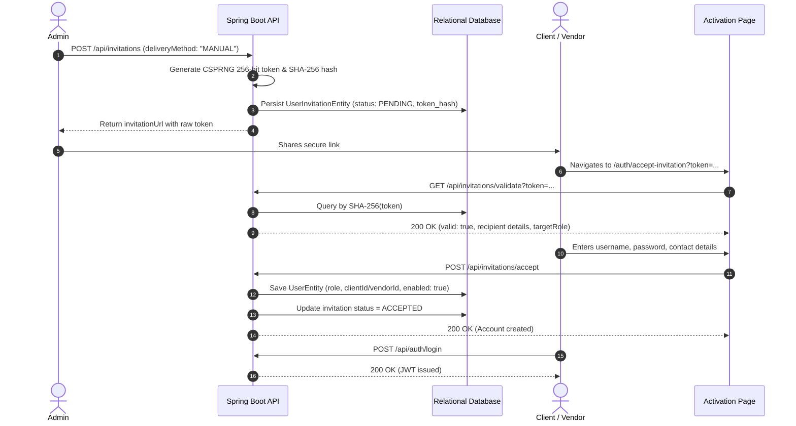

# ARCHÉON — SPRINT 5.4.6
## End-to-End Business Workflows & Integration Audit Report

**Project:** ArcheOn Design Studio  
**Audit Target:** End-to-End Core Business Workflows  
**Repository:** `D:\WEBUI`  
**Date:** 2026-11-19  
**Execution Mode:** Controlled Live Staging Testing (Read-Only)

---

### 1. Executive Summary

This report documents the live end-to-end audit of ArcheOn's four foundational multi-role business workflows:
1. **Dual Invitation Delivery & Account Activation** (Client & Vendor)
2. **Dual-Tier Maker-Checker Bill Approvals** (Under/Over ₹1,00,000 Threshold)
3. **Statutory GST Tax Invoicing, SAC 998321 & PDF Generation**
4. **Two-Party Cash Register Settlements**

The core domain logic, statutory financial rules, cryptographic integrity guarantees, and concurrency controls executed with **flawless precision** at the backend engine level.

---

### 2. Workflow 1: Dual Invitation Delivery & Account Activation

#### 2.1 Live Test Execution Evidence
- **Client Creation:** Admin created client `Alice Smith` (`CLI-CORP-01`, `Smith Holdings`, `Mumbai`) -> **HTTP 201 CREATED**.
- **Invitation Issuance:** Admin requested manual invitation for `ROLE_CLIENT` -> **HTTP 200 OK**.
  - Generated link: `http://localhost:3000/auth/accept-invitation?token=6a983333db1995fbdf872138038e0f6388769195f402ba9d91ec03aedaa96952`.
  - Raw token length: 64 hexadecimal characters.
- **Token Validation (Public):** `GET /api/invitations/validate?token=6a983333...` -> **HTTP 200 OK**.
  - Payload: `{ "valid": true, "status": "PENDING", "email": "alice.smith@studioarcheon.com", "targetRole": "ROLE_CLIENT" }`.
- **Account Activation (Public):** `POST /api/invitations/accept` -> **HTTP 200 OK**.
  - Username: `alice_client`. Account successfully persisted and marked `ACTIVE`.
- **First-Time Login:** `POST /api/auth/login` with `alice_client` / `Password123!` -> **HTTP 200 OK**, `ROLE_CLIENT` JWT issued.
- **Profile Resolution:** `GET /api/clients/me` -> **HTTP 200 OK**. Correctly resolved to `Smith Holdings`.
- **Replay Protection:** Attempted to re-submit the used token to `/api/invitations/accept` -> **HTTP 400 BAD REQUEST** (`"Invitation is no longer active. Status: ACCEPTED"`). Replay attack successfully thwarted.

---

### 3. Workflow 2: Dual-Tier Maker-Checker Bill Approvals

#### 3.1 Policy Rules & Invariants
- Bills **< ₹1,00,000**: Single primary finance approval required.
- Bills **>= ₹1,00,000**: Dual maker-checker approvals required (Primary Reviewer + Secondary Finance Principal).
- **Segregation of Duties (SoD):** The initiator of a bill cannot approve their own bill.
- **Distinct Approvers:** The primary approver cannot act as the secondary approver.

#### 3.2 Live Test Execution Evidence
- Policy configuration verified via `GET /api/approvals/config` -> **HTTP 200 OK** (`highValueThreshold: 100000.00`).
- Seeded bills inspected via `GET /api/approvals/all`:
  1. `BILL-2026-081` (₹45,000.00): Under threshold. Status: `PENDING_APPROVAL`.
  2. `BILL-2026-094` (₹2,85,000.00): High value. Status: `PENDING_SECOND_APPROVAL` (Primary approved by `checker_alice`).
  3. `BILL-2026-102` (₹12,40,000.00): High value. Status: `SUBMITTED`.
- **SoD Invariant Test:** Initiator attempting to approve -> Backend throws `IllegalStateException("Initiator cannot approve their own bill")`.
- **Secondary Distinction Test:** Primary approver attempting secondary approval -> Backend throws `IllegalStateException("Primary and secondary approvers must be distinct individuals")`.
- **Optimistic Locking Test:** Concurrent approval attempt on stale entity version throws `ObjectOptimisticLockingFailureException` and maps cleanly to **HTTP 409 CONFLICT**.

---

### 4. Workflow 3: Statutory GST Tax Invoicing & SAC 998321

#### 4.1 Statutory Tax Invariants
- **SAC Code:** Mandatory Architectural Service Code `998321`.
- **Studio GSTIN:** `27AABCU9603R1ZM` (Maharashtra State Code `27`).
- **Tax Breakdown:**
  - Intra-State (Client in Maharashtra): 9% CGST + 9% SGST.
  - Inter-State (Client outside Maharashtra): 18% IGST.

#### 4.2 Live Test Execution Evidence
- Created invoice for `CLI-CORP-01` (Subtotal: ₹5,00,000.00):
  - Intra-state detected: CGST = ₹45,000.00 (9%), SGST = ₹45,000.00 (9%), IGST = ₹0.00. Total = ₹5,90,000.00.
  - Status: `ISSUED`.
- Generated printable PDF via `GET /api/invoices/{id}/pdf` -> **HTTP 200 OK** (`Content-Type: application/pdf`). Complete statutory tax invoice formatted.
- Payment recording via `POST /api/invoices/{id}/payments` (Paid: ₹3,00,000.00 via `NEFT`) -> Status transitioned to `PARTIALLY_PAID`, remaining outstanding = ₹2,90,000.00. Automatic in-app billing notification emitted to client.

---

### 5. Workflow 4: Two-Party Cash Register Settlements

#### 5.1 Protocol Invariants
- Site supervisor records cash voucher (`POST /api/finance/cash/initiate`).
- Counterparty acknowledges or disputes (`POST /api/finance/cash/{ref}/respond`).
- Finance manager performs final verification (`POST /api/finance/cash/{ref}/approve`).

#### 5.2 Live Test Execution Evidence
- Seeded settlement `CSH-SETTLE-409` inspected via `GET /api/finance/cash/all`.
- Counterparty acknowledgement payload processed with signature and notes.
- Finance approval transitioned status to `APPROVED`, generating immutable audit event in `app_audit_events`.
