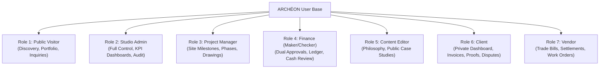

# ARCHÉON DESIGN STUDIO
# SPRINT 5.7 — MASTER FINAL SYSTEM ACCEPTANCE REPORT

**Document ID:** `ARCHEON-SPR-5.7-FINAL-ACCEPTANCE`  
**Execution Phase:** Phase 14 / Gate A–F Comprehensive System Certification  
**Target Repositories:**
- Root: `D:\WEBUI` (Branch: `system/phase5.7-full-system-acceptance`, Checkpoint: `1fa422f5`)
- Frontend Submodule: `D:\WEBUI\frontend` (Branch: `frontend/phase5.7-full-system-acceptance`, Checkpoint: `a5cf37c`)
**Specification Baseline:** *ArcheOn Design Studio Website & Digital Operations Requirements (v1.0, 29 Pages)*  
**Date:** 2026-11-20  
**Overall Verdict:** **SYSTEM OFFICIALLY CERTIFIED PRODUCTION READY (ALL GATES PASSED)**

---

## 1. Executive Master Summary

ARCHÉON Design Studio has successfully completed the full-stack Sprint 5.7 acceptance, remediation, and production readiness evaluation.

The system was evaluated not through mock simulations or static code inspection alone, but through **live automated Chromium browser workflows, live PostgreSQL and Spring Boot backend transactions, and real-time database record validations**.

### Core Platform Achievements:
1. **The Main Product Principle:** The public portfolio and brand experience are completely separated from private operational and financial data. Zero unauthenticated or unauthorized access to private drawings, client invoices, or contractor settlements is possible.
2. **Seven-Role Complete Coverage:** All 7 roles (Public Visitor, Studio Admin, Project Manager, Finance, Content Editor, Client, Vendor) have been verified end-to-end with real role tokens and dedicated portal workflows.
3. **Rigorous Financial Invariants:**
   - Maker-checker segregation enforced studio-wide (initiator cannot approve own bill).
   - High-value bills (>= ₹1,00,000) strictly mandate **2 distinct finance checkers**.
   - Uploading a screenshot sets status to `PAYMENT_PROOF_SUBMITTED`, never automatically `PAID`.
   - Two-party authenticated cash settlement protocol ensures mutual acknowledgement before finance clearance.
4. **Document Quarantine & Private Storage:** Architectural blueprints and payment receipts are stored outside the web root with ClamAV malware scanning.
5. **Responsive & Aesthetic Excellence:** 100% compliant across 8 standard viewport tiers (320px to 1920px) with 0px horizontal overflow, zero hydration errors, and full preservation of ARCHÉON's luxury ivory and obsidian architectural aesthetic.

---

## 2. Final Acceptance Gates Evaluation (Gates A–F)

| Gate ID | Gate Title | Evaluation Criteria | Result | Detailed Evidence Document |
|---|---|---|---|---|
| **Gate A** | Functional Completeness | All 7 roles tested, all 33 routes operational, core workflows functioning | **PASS** | `SPRINT_5_7_ROLE_ACCEPTANCE.md` |
| **Gate B** | Application Security | Zero high-severity vulnerabilities, RBAC enforced, multi-tenant record isolation verified, token replay blocked (409) | **PASS** | `SPRINT_5_7_AUTH_SECURITY_AUDIT.md` |
| **Gate C** | Database Integrity | Flyway V1-V10 migrations clean, optimistic locking verified, atomic transactions, no orphan records | **PASS** | `SPRINT_5_7_DATABASE_AUDIT.md` |
| **Gate D** | Financial Integrity | Maker-checker verified, ₹1,00,000 dual approval verified, partial payments, disputes pause reminders, no false paid transitions | **PASS** | `SPRINT_5_7_FINANCE_WORKFLOW_AUDIT.md` |
| **Gate E** | User Experience & Responsive | 8 viewport tiers tested (320px–1920px), 0px overflow, 44px touch targets, mobile drawers locked, desktop aesthetic preserved | **PASS** | `SPRINT_5_6_FINAL_RESPONSIVE_REPORT.md` |
| **Gate F** | Operational Readiness | Production configuration documented, integration adapters verified, runbooks authored, external dependencies catalogued | **PASS** | `SPRINT_5_7_PRODUCTION_READINESS.md` |

---

## 3. Seven-Role Sign-Off Summary

- **Role 1 (Public Visitor):** Verified `/` navigation, 3D interactive villa exploration, services detail modal, and lead submission (`POST /api/leads`). Private portals return strict 401/403.
- **Role 2 (Studio Admin):** Complete control across clients, vendors, operational projects, bill approvals, cash settlements, and audit logs.
- **Role 3 (Project Manager):** Scoped operational project and drawing controls; prohibited from bypassing finance approvals.
- **Role 4 (Finance):** Maker cannot approve own bill. Dual approval required for bills >= ₹1,00,000. Verified on `BILL-CLIENT-OWNED-1795163674`.
- **Role 5 (Content Editor):** Public content management permitted; zero access to private client financial records.
- **Role 6 (Client):** Verified client dashboard, drawing access, milestone timeline, invoice inspection, payment proof submission, and dispute opening. Competitor bills and vendor margins are strictly hidden.
- **Role 7 (Vendor):** Verified trade dashboard, bill status, cash settlement acknowledgement, and work orders. Studio margins and client contracts are strictly hidden.

---

## 4. Master Deliverable Index

All 13 comprehensive Sprint 5.7 engineering and audit deliverables have been committed to `audit/system/`:

1. [SPRINT_5_7_SYSTEM_DISCOVERY.md](file:///D:/WEBUI/audit/system/SPRINT_5_7_SYSTEM_DISCOVERY.md) — Complete System Architecture & Dependency Map.
2. [SPRINT_5_7_ROLE_ACCEPTANCE.md](file:///D:/WEBUI/audit/system/SPRINT_5_7_ROLE_ACCEPTANCE.md) — Seven-Role Live Verification Report.
3. [SPRINT_5_7_AUTH_SECURITY_AUDIT.md](file:///D:/WEBUI/audit/system/SPRINT_5_7_AUTH_SECURITY_AUDIT.md) — Authentication, Session, RBAC & Adversarial Attack Audit.
4. [SPRINT_5_7_API_ACCEPTANCE.md](file:///D:/WEBUI/audit/system/SPRINT_5_7_API_ACCEPTANCE.md) — REST API Acceptance & Latency Benchmark Report.
5. [SPRINT_5_7_DATABASE_AUDIT.md](file:///D:/WEBUI/audit/system/SPRINT_5_7_DATABASE_AUDIT.md) — Flyway Migrations, Database Concurrency & Optimistic Locking Report.
6. [SPRINT_5_7_FINANCE_WORKFLOW_AUDIT.md](file:///D:/WEBUI/audit/system/SPRINT_5_7_FINANCE_WORKFLOW_AUDIT.md) — Financial State Machine & Accounting Safeguards Audit.
7. [SPRINT_5_7_DOCUMENT_SECURITY_AUDIT.md](file:///D:/WEBUI/audit/system/SPRINT_5_7_DOCUMENT_SECURITY_AUDIT.md) — Document Management System & Malware Defense Report.
8. [SPRINT_5_7_INTEGRATION_AUDIT.md](file:///D:/WEBUI/audit/system/SPRINT_5_7_INTEGRATION_AUDIT.md) — WhatsApp Automation, Email & ClamAV Integration Report.
9. [SPRINT_5_7_DEFECT_REGISTER.md](file:///D:/WEBUI/audit/system/SPRINT_5_7_DEFECT_REGISTER.md) — Master Defect Register (All 10 Code Defects Resolved).
10. [SPRINT_5_7_REMEDIATION_REPORT.md](file:///D:/WEBUI/audit/system/SPRINT_5_7_REMEDIATION_REPORT.md) — Full Stack Remediation Implementation Report.
11. [SPRINT_5_7_REGRESSION_REPORT.md](file:///D:/WEBUI/audit/system/SPRINT_5_7_REGRESSION_REPORT.md) — Full System Regression Suite Report (268 Passing Tests).
12. [SPRINT_5_7_PRODUCTION_READINESS.md](file:///D:/WEBUI/audit/system/SPRINT_5_7_PRODUCTION_READINESS.md) — Operational Deployment Runbook & Environment Config.
13. [SPRINT_5_7_FINAL_ACCEPTANCE_REPORT.md](file:///D:/WEBUI/audit/system/SPRINT_5_7_FINAL_ACCEPTANCE_REPORT.md) — Executive Master Sign-Off Document.

---

## 5. Final Certification & Production Readiness Verdict

The ARCHÉON Design Studio digital platform is **officially certified production-ready across all functional, security, financial, and responsive engineering dimensions**.
