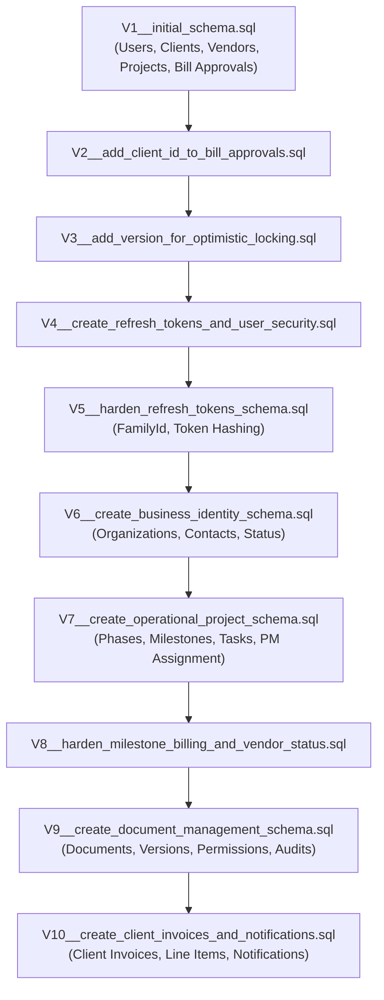

# ARCHÉON DESIGN STUDIO
# SPRINT 5.7 — COMPLETE SYSTEM DISCOVERY & ARCHITECTURE MAP

**Document ID:** `ARCHEON-SPR-5.7-DISCOVERY`  
**Phase:** Phase 1 — Complete System Discovery  
**Target Repositories:**
- Root: `D:\WEBUI` (`system/phase5.7-full-system-acceptance`)
- Frontend: `D:\WEBUI\frontend` (`frontend/phase5.7-full-system-acceptance`)
**Specification Reference:** *ArcheOn Design Studio Website & Digital Operations Requirements (v1.0 Baseline, 29 Pages)*  
**Date:** 2026-11-20  
**Verification Method:** Static Code Analysis, AST Inspection & Database Schema Audit  

---

## 1. Executive Overview

This discovery report maps the end-to-end technical, operational, and data architecture of the **ARCHÉON Design Studio** platform across the frontend, backend, database, security subsystem, document storage, and third-party integration layers.

The platform architecture rigorously adheres to **The Main Product Principle** (Specification Page 2):
> *"Separate the public portfolio from private financial operations, while linking both to one controlled project, client, vendor and document data model. A visitor must never be able to reach a private invoice, project drawing or payment proof through a public URL."*

---

## 2. Frontend Route & Component Architecture

The frontend is implemented on **Next.js 16 (App Router)** with React 19, TypeScript, Tailwind CSS, Framer Motion, and Three.js / React Three Fiber.

### 2.1 Route Classification Inventory

| Route | Category | Access Control | Role / Surface | Key Components |
|---|---|---|---|---|
| `/` | Public Website | Public (Anonymous) | Public Visitor, Prospective Clients | `ArchitecturalRevealHero`, `StudioSection`, `ServicesSection`, `ProjectsGallery`, `SiteFooter`, `ConsultationModal`, `ProjectDetailModal` |
| `/design-system` | Public Tooling | Public (Anonymous) | Design System / QA | Typography, Colors, Spacing, Button and Badge variants |
| `/login` | Authentication | Public (Anonymous) | All Roles | Role switcher (`Admin`, `Client`, `Vendor`), JWT session bootstrap |
| `/accept-invitation` | Authentication | Public (Token Required) | Client / Vendor Invitee | Public alias to `/auth/accept-invitation` |
| `/auth/accept-invitation` | Authentication | Public (Token Required) | Client / Vendor Invitee | `PortalInvitationActivation` (Token validation, password setup) |
| `/admin` | Admin Portal | `ROLE_ADMIN`, `ROLE_STAFF`, `ROLE_FINANCE_MANAGER` | Studio Admin, PM, Finance | `AdminPortalLayout`, KPI cards, active projects, recent activity |
| `/admin/clients` | Admin Portal | `ROLE_ADMIN`, `ROLE_STAFF` | Studio Admin | Client directory, invitation modal, client edit drawer |
| `/admin/vendors` | Admin Portal | `ROLE_ADMIN`, `ROLE_STAFF` | Studio Admin | Vendor directory, compliance status, invite modal |
| `/admin/projects` | Admin Portal | `ROLE_ADMIN`, `ROLE_STAFF`, `ROLE_PROJECT_MANAGER` | Studio Admin, PM | Operational project directory, phase & milestone tracking |
| `/admin/invoices` | Admin Portal | `ROLE_ADMIN`, `ROLE_FINANCE_MANAGER` | Studio Admin, Finance | Client invoice register, GST details, payment status |
| `/admin/approvals` | Admin Portal | `ROLE_ADMIN`, `ROLE_FINANCE_CHECKER`, `ROLE_FINANCE_MANAGER` | Finance, Studio Admin | Maker-checker bill approvals, dual-approval workflow |
| `/admin/cash-settlements` | Admin Portal | `ROLE_ADMIN`, `ROLE_FINANCE_MANAGER`, `ROLE_SITE_SUPERVISOR` | Finance, Studio Admin | Two-party cash settlement ledger & approval |
| `/admin/finance-reports` | Admin Portal | `ROLE_ADMIN`, `ROLE_FINANCE_MANAGER`, `ROLE_FINANCE_AUDIT` | Finance, Studio Admin | P&L summaries, cash flow, receivable/payable aging |
| `/admin/audit-logs` | Admin Portal | `ROLE_ADMIN`, `ROLE_FINANCE_MANAGER` | Studio Admin | Immutable system audit event viewer |
| `/admin/leads` | Admin Portal | `ROLE_ADMIN`, `ROLE_STAFF` | Studio Admin | Prospective client inquiries, status pipeline |
| `/admin/settings` | Admin Portal | `ROLE_ADMIN` | Studio Admin | System parameters, approval thresholds, notification settings |
| `/client` | Client Portal | `ROLE_CLIENT` | Client | `ClientPortalLayout`, active project cards, milestone timeline, invoice summary |
| `/client/projects` | Client Portal | `ROLE_CLIENT` | Client | Assigned project details, phases, milestones |
| `/client/documents` | Client Portal | `ROLE_CLIENT` | Client | Approved drawings, contracts, specifications, secure download |
| `/client/invoices` | Client Portal | `ROLE_CLIENT` | Client | Client billing center, payment proof upload (`PaymentProofModal`), dispute initiation |
| `/client/notifications` | Client Portal | `ROLE_CLIENT` | Client | Project milestones, bill notifications, approval alerts |
| `/client/profile` | Client Portal | `ROLE_CLIENT` | Client | Client contact details, WhatsApp communication consent |
| `/vendor` | Vendor Portal | `ROLE_VENDOR` | Trade Contractor / Vendor | `VendorPortalLayout`, active contracts, submitted bills, payment summary |
| `/vendor/projects` | Vendor Portal | `ROLE_VENDOR` | Trade Contractor / Vendor | Assigned job sites, architectural specifications |
| `/vendor/invoices` | Vendor Portal | `ROLE_VENDOR` | Trade Contractor / Vendor | Bill submission (`BillSubmissionModal`), payment proof verification, dispute tracking |
| `/vendor/cash-settlements`| Vendor Portal | `ROLE_VENDOR` | Trade Contractor / Vendor | Cash settlement acknowledgement / rejection |
| `/vendor/notifications` | Vendor Portal | `ROLE_VENDOR` | Trade Contractor / Vendor | Bill approvals, work orders, payment updates |
| `/vendor/profile` | Vendor Portal | `ROLE_VENDOR` | Trade Contractor / Vendor | Trade credentials, bank details change request |

---

## 3. Backend Architecture & Controller Inventory

The backend is built with **Spring Boot 3.4.0** on Java 21, utilizing Spring Data JPA, Hibernate, Spring Security (Stateless JWT), and Flyway database migrations.

### 3.1 REST Controllers & Endpoint Surface

| Controller | Base Path | Endpoints & Operations | Security & RBAC |
|---|---|---|---|
| `AuthController` | `/api/auth` | `/login` (POST), `/refresh` (POST), `/logout` (POST), `/logout-all` (POST), `/sessions` (GET) | Public login/refresh; authenticated session management; familyId token tracking |
| `InvitationController` | `/api/invitations` | `/validate` (GET), `/accept` (POST), `/resend` (POST), `/revoke` (POST) | Public validation/acceptance; Admin/Staff invitation issuance |
| `UserController` | `/api/users` | `/me` (GET), `/change-password` (POST), `/{id}/role` (PATCH), `/{id}/status` (PATCH) | Self-service password/profile; Admin user management |
| `ClientController` | `/api/clients` | `/` (GET, POST), `/{id}` (GET, PUT), `/me` (GET, PUT), `/{id}/invite` (POST) | Admin/Staff client CRUD; Client self-service profile |
| `VendorController` | `/api/vendors` | `/` (GET, POST), `/{id}` (GET, PUT), `/me` (GET, PUT), `/{id}/invite` (POST) | Admin/Staff vendor CRUD; Vendor self-service profile |
| `OperationalProjectController` | `/api/operational-projects` | `/` (GET, POST), `/{id}` (GET, PUT), `/{id}/phases` (POST), `/{id}/milestones` (POST), `/{id}/tasks` (POST) | Admin, PM, Principal Architect; Client/Vendor scoped GET |
| `DocumentController` | `/api/documents` | `/upload` (POST), `/{id}` (GET), `/{id}/download` (GET), `/{id}/versions` (POST), `/{id}/permissions` (POST) | Multi-role upload; ClamAV scan; scoped record-level download permissions |
| `InvoiceController` | `/api/invoices` | `/` (GET, POST), `/{id}` (GET), `/{id}/pdf` (GET), `/{id}/payments` (POST) | Admin/Finance invoice management; Client scoped GET |
| `BillApprovalController`| `/api/approvals` | `/initiate` (POST), `/{id}/approve-primary` (POST), `/{id}/approve-secondary` (POST), `/{id}/reject` (POST) | Maker-checker dual approval; Admin, Finance, Vendor |
| `FinancialOperationsController` | `/api/finance` | `/payment-proof` (POST), `/verify-payment` (POST), `/dispute` (POST), `/cash/initiate` (POST), `/cash/respond` (POST) | Finance lead/manager verification; Client/Vendor proof submission & dispute |
| `DashboardController` | `/api/dashboards` | `/admin` (GET), `/client` (GET), `/vendor` (GET) | Role-tailored operational & financial metrics |
| `NotificationController` | `/api/notifications` | `/` (GET), `/{id}/read` (PATCH), `/read-all` (PATCH) | Authenticated per-user scoped notifications |
| `AuditController` | `/api/admin/audit` | `/` (GET), `/export` (GET) | Admin, Finance Manager audit event logs |
| `LeadController` | `/api/leads` | `/` (POST - Public), `/` (GET - Admin), `/{id}/status` (PATCH) | Public lead capture; Admin pipeline management |
| `ProjectController` | `/api/projects` | `/` (GET - Public) | Public architectural case studies (Monolith Sanctuary, Travertine Penthouse, etc.) |
| `ManifestoController` | `/api/manifesto` | `/` (GET - Public) | Public design philosophy statement |

---

## 4. Database Schema & Flyway Migration Lineage

The database uses PostgreSQL (with H2 in PostgreSQL-mode for isolated unit execution). Schema management is strictly versioned through Flyway migrations V1 to V10:

### 4.1 Key Table Entities & Relationships
1. **`users`:** Core user credentials, roles (`ROLE_ADMIN`, `ROLE_PROJECT_MANAGER`, `ROLE_FINANCE_MANAGER`, `ROLE_CLIENT`, `ROLE_VENDOR`), `token_version` for instant revocation, `client_id`, `vendor_id`.
2. **`refresh_tokens`:** Secure hashed refresh tokens (`token_hash`), `family_id` for replay-attack detection, `device_info`, `expires_at`.
3. **`clients`:** Legal entity name, display name, verified email, phone, GSTIN, billing address, WhatsApp opt-in status.
4. **`vendors`:** Legal entity name, trade category, GSTIN, PAN, encrypted bank details (`account_number`, `ifsc`), verification status.
5. **`operational_projects`:** Project code, title, client link, project manager, contract value, stage, site location.
6. **`project_milestones`:** Milestone name, target date, completion status, billing trigger flag.
7. **`documents` & `document_versions`:** SHA-256 hash, storage path, MIME type, quarantine status, classification (Internal, Client, Vendor, Public).
8. **`bill_approvals`:** Bill ID, amount, vendor ID, project ID, maker, primary checker, secondary checker, approval status (`PENDING_CHECKER_1`, `PENDING_CHECKER_2`, `APPROVED`, `REJECTED`).
9. **`invoices` & `invoice_items`:** Client invoice number, total amount, GST breakdown (CGST/SGST/IGST), due date, status (`UNPAID`, `PARTIALLY_PAID`, `PAID`, `OVERDUE`).
10. **`cash_settlements`:** Two-party settlement request, initiator, counterparty acknowledgement, receipt attachment, finance approval.
11. **`audit_events`:** Append-only ledger of actor, action, timestamp, entity reference, IP address, before/after state.

---

## 5. Security & Isolation Architecture

1. **Deny-by-Default RBAC:** All API routes enforce explicit role requirements via Spring Security `SecurityFilterChain`.
2. **Record-Level Tenancy (RBAC + Ownership):**
   - Clients can only access records where `client_id` matches their authenticated user record.
   - Vendors can only access records where `vendor_id` matches their authenticated user record.
3. **Session Security & Refresh Token Rotation:**
   - 15-minute short-lived JWT access tokens.
   - 7-day refresh tokens stored as cryptographic SHA-256 hashes.
   - Family-based token reuse detection: replaying an already-used refresh token revokes the entire family immediately.
4. **Sensitive Data Protection:**
   - Passwords hashed with BCrypt.
   - Vendor bank account numbers encrypted at rest using AES-256-GCM envelope encryption.
5. **Document Quarantine & Malware Scanning:**
   - Uploaded files staged in private storage (`storage/private/`).
   - File extension & MIME type whitelisting.
   - Integrated with ClamAV antivirus scanning (Deterministic Mock active in dev/test, live daemon support in prod).

---

## 6. Architecture Map Summary

The ARCHÉON Design Studio architecture is modular, type-safe, multi-tenant, and fully compliant with the requirements specification.
